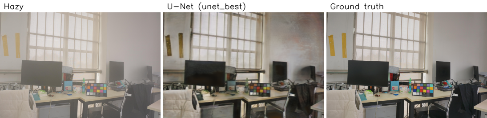

# De-Haze

Removes haze from images and videos with a trained U-Net or Pix2Pix model
(TensorFlow/Keras), then counts people in the result with OpenCV's HOG detector.

Forked from [paulrounak/De-Haze](https://github.com/paulrounak/De-Haze).

## Models

- **U-Net**: encoder-decoder with skip connections, sigmoid output, MSE loss.
  31,379,075 parameters.
- **Pix2Pix**: the same U-Net as generator, plus a 70x70 PatchGAN discriminator used
  only during training. Loss: GAN loss + 100 x L1.

Both take a 256x256 BGR image and return a 256x256 BGR image.

## Pipeline

1. **Preprocess** (`preprocess.py`): CLAHE on the L channel (LAB), then L-40 / S+30 in
   HLS, on the full-size image; then resize to 256x256 with `INTER_AREA`.
2. **Dehaze** (`infer.py`): run the model, resize the output back to the input size.
3. **Detect** (`detect.py`): HOG people detector on the dehazed output (or on the input
   with `--detect-on hazy`).

Each saved model has a `.json` file next to it with its preprocess mode; `infer.py`
and `evaluate.py` read it so the input matches training.

## Setup

```
git clone https://github.com/raghavxd11/De-Haze.git
cd De-Haze
pip install -r requirements.txt
```

TensorFlow 2.11+ has no GPU support on native Windows, so it runs on the CPU there.

Dataset: put the images in `dataset/Hazy_Full/` and `dataset/GT_Full/`
(2,036 pairs, `01_hazy.png` / `01_GT.png`, ...). IDs 01-55 are outdoor, the rest indoor.
The train/val/test split is fixed in `splits/split_v1.json` (similar rooms are grouped
so a room is never in two splits; see `BENCHMARK.md`).

## Train

```
python train.py --model unet
python train.py --model pix2pix
python train.py --model unet --small --epochs 1   # quick check on 55 images, not for results
```

Models go to `outputs/models/<model>/`: the final model, the best one
(lowest validation loss) as `<name>_best.keras`, and `log.csv` with one row per epoch.
A checkpoint is saved every epoch; running the same command again resumes.
Training stops early after 5 epochs without improvement in validation loss.
Run `python train.py --help` for all options.

To train on Kaggle: `python kaggle/make_code_zip.py`, upload `outputs/de-haze-code.zip`
as a dataset, and run `kaggle/train_kaggle.ipynb` with a GPU.

## Infer

```
python infer.py --model-path outputs/models/unet/unet_best.keras --input sample_test_files/hazed_img.jpg
python infer.py --model-path outputs/models/unet/unet_best.keras --input sample_test_files/test_vid.mp4 --no-display
```

Output is saved in `outputs/` at the input's size. Options: `--output`, `--no-display`,
`--no-detect`, `--detect-on dehazed|hazy`, `--preprocess`. Press `q` to stop a video.

## Evaluate

```
python evaluate.py --model-path outputs/models/unet/unet_best.keras \
                   --model-path outputs/models/pix2pix/p2p_best.keras \
                   --compare-dcp --split test
```

Writes `outputs/results.md`, `outputs/results.csv` and `outputs/results_per_image.csv`
(overwritten on each run). DCP (Dark Channel Prior, `baselines/dcp.py`) is a
non-learned baseline.

## Results (test split, 213 images, 19 scene groups)

Mean of per-scene-group means, with 95% bootstrap CI over scene groups.
Measured 2026-11-11 on CPU. Full table and protocol: [BENCHMARK.md](BENCHMARK.md).

| Method | Subset | PSNR [95% CI] | SSIM [95% CI] |
| --- | --- | --- | --- |
| U-Net | overall | 18.45 [17.23, 19.69] | 0.7098 [0.6430, 0.7729] |
| U-Net | indoor (207) | 19.91 [18.95, 20.97] | 0.7813 [0.7314, 0.8287] |
| U-Net | outdoor (6) | 15.26 [14.38, 16.28] | 0.5550 [0.4614, 0.6278] |
| Pix2Pix | overall | 17.69 [16.42, 18.96] | 0.6709 [0.6043, 0.7352] |
| Pix2Pix | indoor (207) | 19.12 [17.96, 20.40] | 0.7383 [0.6821, 0.7942] |
| Pix2Pix | outdoor (6) | 14.58 [13.79, 15.33] | 0.5251 [0.4401, 0.5973] |
| DCP | overall | 13.35 [11.86, 15.06] | 0.6183 [0.5375, 0.7000] |
| DCP | indoor (207) | 14.17 [12.23, 16.43] | 0.7159 [0.6567, 0.7765] |
| DCP | outdoor (6) | 11.57 [10.23, 12.89] | 0.4069 [0.3130, 0.5007] |

Both models have higher PSNR than DCP (CIs do not overlap). On SSIM the CIs overlap.
The U-Net and Pix2Pix CIs overlap everywhere, so neither is shown to be better.
DCP is about 100x faster on CPU (11.9 ms vs about 1,100 ms per image).

## Samples

Three test-split images (not seen in training), `unet_best.keras`, made with `infer.py`.
Left to right: hazy input, U-Net output, ground truth.

Outdoor, image 06 (PSNR 17.52; outdoor median 15.25). Dense haze: the structure comes
back but most of the color does not.


Indoor, image 103 (PSNR 22.31; indoor median 20.25).



Indoor, image 1212 (PSNR 19.18).


Images were chosen by a fixed rule (first outdoor test image, first image of the two
lowest-numbered indoor test groups), not by score.

## Limitations

- About 97% of the data is indoor; the outdoor test set has only 6 images.
- The test set has 19 scene groups, so confidence intervals are wide.
- U-Net overfits: at its best epoch train loss is 0.0027 and val loss 0.0190.
- Validation scores were used to pick the best epoch, so they are optimistic.
- Everything is done at 256x256 (aspect ratio not kept); outputs are upscaled back,
  so fine detail is lost and some outputs show blotchy texture.
- One training run per model.
- PSNR and SSIM do not fully match how a person judges image quality.
- HOG people detection is not evaluated.

More in [BENCHMARK.md](BENCHMARK.md).

## Files

| File | Purpose |
| --- | --- |
| `config.py` | sizes, epochs, paths, split settings |
| `data.py` | loading, caching, `tf.data` pipeline |
| `preprocess.py` | CLAHE/HLS preprocessing |
| `models.py` | U-Net, PatchGAN, losses |
| `train.py` | training for both models |
| `infer.py` | image/video inference |
| `detect.py` | HOG people detection |
| `evaluate.py` | test-split scoring |
| `baselines/dcp.py` | Dark Channel Prior baseline |
| `split.py` | builds `splits/split_v1.json` |
| `kaggle/` | Kaggle notebook and code zip script |

Trained models from the original repository (not the ones measured above):
https://drive.google.com/drive/folders/1Uh8nfn4vCnb6XOZRrU2qhV-IaLTSqJNp?usp=sharing
