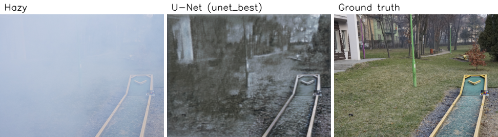
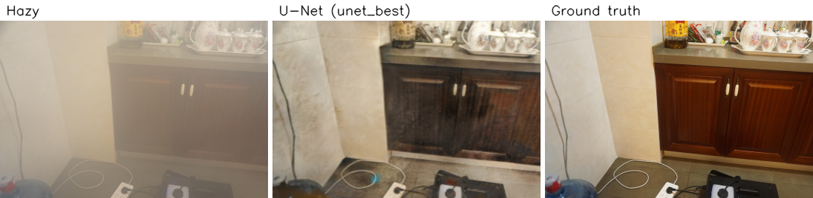

# De-Haze

Removes haze from images and videos with a trained U-Net or Pix2Pix model
(TensorFlow/Keras), then counts people in the result with OpenCV's HOG detector.

Based on [paulrounak/De-Haze](https://github.com/paulrounak/De-Haze) by Rounak Paul.
The original U-Net / Pix2Pix dehazing and HOG people detection are from that project.

## Changes from the original

- One shared input preparation (`prepare_input` in `preprocess.py`) for training and
  inference. The original resized before preprocessing for single images at inference,
  but preprocessed before resizing in training.
- People detection runs after dehazing, and boxes are never drawn on the model input.
- The Pix2Pix discriminator is now a PatchGAN.
- Scene-grouped train/val/test split, saved in `splits/split_v1.json`.
- Command-line tools `train.py`, `infer.py` and `evaluate.py`; training saves a
  checkpoint every epoch and resumes from it.
- PSNR/SSIM evaluation with bootstrap confidence intervals and a Dark Channel Prior
  baseline (see `BENCHMARK.md`).
- Kaggle training notebook (`kaggle/train_kaggle.ipynb`).

This README does not compare our models with the original trained models.

## Setup

```
git clone https://github.com/raghavxd11/De-Haze.git
cd De-Haze
pip install -r requirements.txt
```

TensorFlow 2.11+ has no GPU support on native Windows, so it runs on the CPU there.

For training and evaluation, put the images in `dataset/Hazy_Full/` and
`dataset/GT_Full/` (2,036 pairs, `01_hazy.png` / `01_GT.png`, ...). IDs 01-55 are
outdoor, the rest indoor. The split is fixed in `splits/split_v1.json`.

## Download weights

The trained weights are not stored in git because of their size. Download them from
[Google Drive](https://drive.google.com/drive/folders/1Fe-RD5ahCbl81Zmt51i4dKgplzGB1Jl5?usp=drive_link).

- `unet_best.keras` + `unet_best.json` go in `outputs/models/unet/`
- `p2p_best.keras` + `p2p_best.json` go in `outputs/models/pix2pix/`

Each `.json` file holds the preprocessing mode, so keep it next to its `.keras` file.
Both models were trained on Kaggle with Keras 3.13 and loaded locally with Keras 3.15.
No dataset is needed to run inference.

## Usage

Both models take a 256x256 BGR image and return a 256x256 BGR image; `infer.py`
resizes the output back to the input size.

**Infer**

```
python infer.py --model-path outputs/models/unet/unet_best.keras --input sample_test_files/hazed_img.jpg
python infer.py --model-path outputs/models/unet/unet_best.keras --input sample_test_files/test_vid.mp4 --no-display
```

Output is saved in `outputs/`. Options: `--output`, `--no-display`, `--no-detect`,
`--detect-on dehazed|hazy`, `--preprocess`. Press `q` to stop a video.

**Train**

```
python train.py --model unet
python train.py --model pix2pix
```

The best model (lowest validation loss) is saved as `outputs/models/<model>/<name>_best.keras`.
Running the same command again resumes from the last checkpoint. Training stops after
5 epochs without improvement. On Kaggle: run `python kaggle/make_code_zip.py`, upload
`outputs/de-haze-code.zip` as a dataset, and run `kaggle/train_kaggle.ipynb` with a GPU.

**Evaluate**

```
python evaluate.py --model-path outputs/models/unet/unet_best.keras \
                   --model-path outputs/models/pix2pix/p2p_best.keras \
                   --compare-dcp --split test
```

Writes `outputs/results.md`, `outputs/results.csv` and `outputs/results_per_image.csv`.

**Tests**: `pip install pytest`, then `python -m pytest tests`.

## Results (test split, 213 images, 19 scene groups)

Mean of per-scene-group means, with 95% bootstrap CI over scene groups.
Measured 2026-11-11 on CPU. Full table and protocol: [BENCHMARK.md](BENCHMARK.md).

| Method | Subset | PSNR [95% CI] | SSIM [95% CI] |
| --- | --- | --- | --- |
| U-Net | overall | 18.45 [17.23, 19.69] | 0.7098 [0.6430, 0.7729] |
| U-Net | indoor (207) | 19.91 [18.95, 20.97] | 0.7813 [0.7314, 0.8287] |
| U-Net | outdoor (6) | 15.26 [14.38, 16.28] | 0.5550 [0.4614, 0.6278] |
| Pix2Pix | overall | 17.69 [16.42, 18.96] | 0.6709 [0.6043, 0.7352] |
| Pix2Pix | indoor (207) | 19.12 [17.96, 20.40] | 0.7383 [0.6821, 0.7942] |
| Pix2Pix | outdoor (6) | 14.58 [13.79, 15.33] | 0.5251 [0.4401, 0.5973] |
| DCP | overall | 13.35 [11.86, 15.06] | 0.6183 [0.5375, 0.7000] |
| DCP | indoor (207) | 14.17 [12.23, 16.43] | 0.7159 [0.6567, 0.7765] |
| DCP | outdoor (6) | 11.57 [10.23, 12.89] | 0.4069 [0.3130, 0.5007] |

Both models have higher PSNR than DCP (CIs do not overlap). On SSIM the CIs overlap.
The U-Net and Pix2Pix CIs overlap everywhere, so neither is shown to be better.
DCP is about 100x faster on CPU (11.9 ms vs about 1,100 ms per image).

## Samples

Three test-split images (not seen in training), `unet_best.keras`.
Left to right: hazy input, U-Net output, ground truth. Chosen by a fixed rule, not by score.

Outdoor, image 06 (PSNR 17.52; outdoor median 15.25). Dense haze: the structure comes
back but most of the color does not.



Indoor, image 103 (PSNR 22.31; indoor median 20.25).


Indoor, image 1212 (PSNR 19.18).



## Limitations

- About 97% of the data is indoor; the outdoor test set has only 6 images.
- The test set has 19 scene groups, so confidence intervals are wide.
- U-Net overfits: at its best epoch train loss is 0.0027 and val loss 0.0190.
- Everything runs at 256x256 (aspect ratio not kept), so fine detail is lost.
- One training run per model. HOG people detection is not evaluated.

More in [BENCHMARK.md](BENCHMARK.md).

## Files

| File | Purpose |
| --- | --- |
| `config.py` | sizes, epochs, paths, split settings |
| `data.py` | loading, caching, `tf.data` pipeline |
| `preprocess.py` | CLAHE/HLS preprocessing |
| `models.py` | U-Net, PatchGAN, losses |
| `train.py` | training for both models |
| `infer.py` | image/video inference |
| `detect.py` | HOG people detection |
| `evaluate.py` | test-split scoring |
| `baselines/dcp.py` | Dark Channel Prior baseline |
| `split.py` | builds `splits/split_v1.json` |
| `kaggle/` | Kaggle notebook and code zip script |
